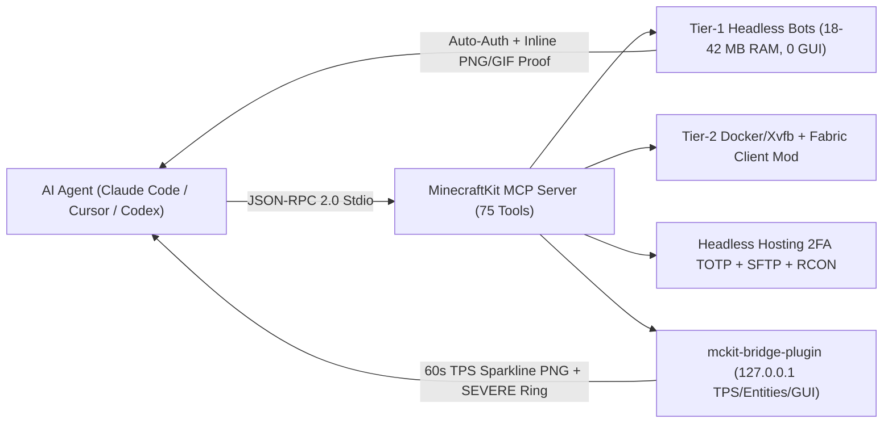

# Salyyy Minecraft Kit

[Tiếng Việt (README.vi.md)](README.vi.md) · [**Flagship Showcase**](https://salyys1.github.io/minecraftkit/showcase.html) · [RPG API Explorer](https://salyys1.github.io/minecraftkit/) · [Ecosystem Atlas](https://salyys1.github.io/minecraftkit/ecosystem.html) · [Diagnostics Lab](https://salyys1.github.io/minecraftkit/playground.html) · [Documentation Wiki](https://salyys1.github.io/minecraftkit/wiki.html) · [Hosting 2FA & SFTP Guide](docs/HOSTING_2FA_SFTP_GUIDE.md) · [Bot RAM Benchmarks](docs/BOT_OPTIMIZATION_BENCHMARKS.md) · [Growth Playbook](docs/GROWTH_STRATEGY.md) · [npm](https://www.npmjs.com/package/minecraftkit)

[](https://github.com/SalyyS1/minecraftkit/actions/workflows/ci.yml)
[](https://github.com/SalyyS1/minecraftkit/releases/tag/v6.0.0)
[](https://glama.ai/mcp/servers/SalyyS1/minecraftkit)
[](https://modelcontextprotocol.io)

Flagship **v6.0.0** (**75 Stdio MCP Tools · 6 Cloud Bot Grids · Live Java 21 Visual Mod Bridge!**) all-in-one Minecraft plugin engineering, autonomous headless bot QA (1-Call Server Fingerprint + Java SLP + Wire-Level Login->Config->Play Command Probe + ViaVersion/Geyser Protocol Matrix + Bounded Multi-Bot Stress Benchmark + AuthMe/nLogin Auto-Auth Auditor + Economy Arbitrage & Multi-Bot Dupe-Race Stress Planner + Stage Replay Regression Comparator + Bedrock/Geyser RakNet UDP + Off-Screen Multi-Stage Storyboard PNG, Animated GIF & Live Bridge TPS Sparkline PNGs + Fabric Xvfb Visual Capture Recipes + Full-Stack Docker Compose & Oracle Always-Free ARM64 / Hetzner / Fly.io / K8s / GHA Cloud Grids + CI Workflow Generator), 1.21+ GLSL Shader, Spark/Timings Tick-Lag & HikariCP/SQL Pool Auditors, Bilingual Modrinth/Hangar/Discord Release-Notes Generator, 5-phase end-to-end lifecycle orchestrator, persistent freeform multi-turn bot sessions, off-screen PNG visual diff, MP4 timelapse & self-contained dark-mode HTML QA proof artifacts, pure-Python Anvil `.mca` world, 1.21+ datapack, LuckPerms RBAC & Velocity/Paper/Geyser-Floodgate proxy forwarding security auditors, plugin anti-dupe/economy exploit auditor, client/server item-model pack parity & cross-plugin conflict auditor, headless hosting/VPS/2FA/WebSocket/RCON/firewall/backup-audit & SFTP operations with a masked profile vault, companion Paper/Folia (`/api/v1/tps-history`, `/api/v1/entities`, `/api/v1/gui`, `/api/v1/errors`) & Fabric testing bridges, 14 `/mc:*` agent skills, unified 10-tool ecosystem doctor, interactive GitHub Pages showcase with Live Bridge TPS Sparkline Lab, Searchable MCP Directory, Stage YAML Builder & VPS Anti-OOM Planner, and a **75-tool stdio MCP server** by **SalyVn / Salyyy**.



## What Salyyy Minecraft Kit Includes

- **Resource-Optimized Autonomous Test Bot Engine (`bot/`, `docker/`, `scripts/bot_engine.py`, `scripts/visual_capture.py`)**:
  - **Tier 1 Headless Protocol Bots (~42 MB RAM/bot, ZERO GUI, ZERO screen lock)**: Auto-joins servers, auto-completes `/register` and `/login` (AuthMe, nLogin, OpeNLogin, LimboAuth, VelocityAuth) with strict password redaction, accepts resource packs, runs stage-based or freeform gameplay assertions, and renders crisp off-screen PNG visual QA snapshots (HUD telemetry, 9×4 GUI/Chest slots, scoreboard, 2D entity minimap, redacted chat) returned directly inside MCP chat responses.
  - **Tier 2 Hybrid Docker/Xvfb Visual Client Grid (`docker/Dockerfile.visual-bot`, `docker/docker-compose.testgrid.yml`)**: Runs 1 containerized off-screen Fabric visual client (Xvfb + Mesa + ffmpeg) alongside N-1 lightweight protocol bots — saving **> 85% RAM** vs opening 10 desktop Minecraft tabs without ever stealing window focus!
- **Companion Testing Plugin & Client Mod (`bridge-plugin/`, `client-mod/`)**:
  - **`mckit-bridge-plugin`** (Paper/Folia Java 21): Token-authenticated loopback (`127.0.0.1:25590`) HTTP/JSON telemetry bridge exposing live TPS/MSPT, JVM heap, loaded chunks, online player GUI states, plugins, and a bounded ring buffer of grouped `SEVERE`/exception traces.
  - **`mckit-client-mod`** (Fabric 1.21.4+): Off-screen framebuffer capture & resource-pack/shader reload error bridge (`127.0.0.1:25591`) for Tier-2 Docker/Xvfb visual QA.
- **Headless Hosting / VPS Panel (with RFC 6238 TOTP 2FA) & SFTP Connector (`scripts/hosting_bridge.py`)**:
  - Connects headlessly to **Pterodactyl**, **Pelican**, **Crafty Controller**, **PufferPanel**, **Multicraft**, and generic web panels via domain, credentials/API key, and built-in pure-Python RFC 6238 TOTP 2FA — zero visible browser popups, strict secret redaction.
  - Full SFTP operations (`list`, `read`, `tail_log` with error highlighting, safe `.mckit.bak` config patching, atomic temp-file + SHA-256 plugin JAR deployment, crash report listing) with path-traversal protection.
- **Unified 10-Repo SalyyS1 Minecraft Toolchain (`scripts/toolchain_bridge.py`)**: Integrates `mcstage`, `shadersmith`, `packmigrate`, `packmerge`, `glyphsmith`, `pluginscope`, `serverdoctor`, `foliascan`, `rp-engine`, and `texlab` into a single `mc_run_qa_pipeline` end-to-end automated QA loop.
- **Offline RPG & Plugin Bytecode API Catalog**: 4,947 plugin-owned types and 41,887 bytecode-verified members across 10 major RPG and server plugins (`ModelEngine`, `MMOItems`, `MMOCore`, `MMOInventory`, `MMOProfiles`, `MythicCrucible`, `MythicDungeons`, `MythicEnchants`, `MythicRPG`, `CoreTools`), plus 103 curated GitHub sources and 901 Mojang release/snapshot records.
- **14 `/mc:*` Engineering Agent Skills**: Specialized routing skills and slash commands for Claude Code, Cursor, Windsurf, Antigravity, and OpenAI Codex covering `mc:bot`, `mc:build`, `mc:core`, `mc:rpg`, `mc:protocol`, `mc:nms`, `mc:ops`, `mc:pack`, `mc:model`, `mc:qa`, `mc:shader`, `mc:dialog`, `mc:client`, and `mc:suite`.
- **75-Tool Stdio MCP Server**: Pure Python 3.10+ JSON-RPC 2.0 MCP server (`scripts/mcp_server.py` and `minecraftkit mcp`) with native multimodal PNG image responses for live visual bot testing, 1-call server fingerprinting (`mc_bot_fingerprint_server`), bridge TPS sparkline charts, self-contained HTML QA proof reports, headless backup auditing, Source RCON, wire-level offline login/play probes, Bedrock/Geyser RakNet UDP pings, 8 plugin stage presets, synced `mcstage` suite generation, pixel-exact visual regression diffs, animated GIF storyboards, and ffmpeg MP4 timelapses.

## Quick Install

Install the canonical skill and all 10 `mc:*` domain wrappers for both Claude Code and Codex (works cross-platform on Windows, Linux, and macOS via PowerShell or the built-in Node.js SHA-256 verified installer):

```bash
npx minecraftkit install --target both
```

Install for a single agent target or install the CLI globally:

```bash
npx minecraftkit install --target claude
npx minecraftkit install --target codex

npm install -g minecraftkit
minecraftkit doctor
```

## Built-In MCP Server (Cursor / Windsurf / Claude Desktop / Claude Code)

Print a ready-to-paste configuration snippet tailored to your local environment:

```bash
npx minecraftkit mcp --print-config
```

Or add `minecraftkit` directly to `.cursor/mcp.json`, `.mcp.json`, or `claude_desktop_config.json`:

```json
{
  "mcpServers": {
    "minecraftkit": {
      "command": "npx",
      "args": ["-y", "minecraftkit", "mcp"]
    }
  }
}
```

If you cloned this repository or installed the skill locally, you can also invoke `scripts/mcp_server.py` directly with zero npm startup overhead:

```json
{
  "mcpServers": {
    "minecraftkit": {
      "command": "python3",
      "args": ["-B", "/path/to/minecraftkit/scripts/mcp_server.py"]
    }
  }
}
```

### Exposed Read-Only MCP Tools

| Tool | Purpose |
| --- | --- |
| `mc_search_api` | Search 41,800+ offline classes, interfaces, methods, fields, and constructors by `terms`, `plugin`, `kind`, and `limit`. |
| `mc_list_plugins` | List all 10 indexed RPG plugins with versions, class-file targets, symbol counts, API boundaries, and integration risks. |
| `mc_search_sources` | Filter 103 curated upstream Minecraft, Paper, Folia, protocol, shader, and pack GitHub repositories with pinned commit SHAs. |
| `mc_version_capabilities` | Query Mojang version history (901 versions), Java requirements, protocol numbers, and resource/data pack formats (including `26.2`). |
| `mc_route_skill` | Recommend primary and secondary `/mc:*` engineering skills, reference handbooks, and verification checklists for a task. |
| `mc_folia_migration_advisor` | Audit Java/Kotlin snippets or Bukkit API symbols for Folia regionized threading hazards and output `RegionScheduler` / `EntityScheduler` / `teleportAsync` replacements. |
| `mc_diagnose_server_log` | Analyze Paper, Folia, Purpur, and Velocity crash logs, watchdog stalls, classloader/shading collisions, and JVM classfile mismatches. |
| `mc_inspect_type` | Inspect the full bytecode hierarchy of any indexed RPG plugin class, interface, enum, or record, including superclass, interfaces, indexed subtypes, constructors, methods, fields, and minimum Java version. |
| `mc_audit_gradle_build` | Audit `build.gradle.kts` / `build.gradle` and `paper-plugin.yml` / `plugin.yml` for bundled server APIs, un-relocated `shadowJar` packages, Paperweight mapping mismatches, Java toolchain gaps, and isolated classloader `join-classpath` issues. |
| `mc_audit_paper_plugin_yml` | Validate `paper-plugin.yml` (and optional dual `plugin.yml`) across Paper `1.19` through `26.3+` for YAML float truncation (`1.20` -> `1.2`), illegal legacy root keys (`commands`, `depend`, `libraries`), `bootstrapper` / `loader` / `main` class collisions, `bootstrap` vs `server` dependency graph ordering conflicts, isolated classloader `join-classpath` visibility, and Folia flags. |
| `mc_generate_pack_overlay` | Generate client- and server-validated `pack.mcmeta` files and `overlays.entries` manifests for resource packs and data packs spanning `1.20.1` through `26.3+` (enforcing `supported_formats` pre-minor clamping at `64`/`81`, `min_format`/`max_format` `[major, minor]` tuples, `OverlayMetadataSection` directory naming rules, and breaking-epoch splits). |
| `mc_audit_server_properties` | Audit `server.properties` alongside optional `config/paper-global.yml`, `spigot.yml`, and JVM flags for `network-compression-threshold` double-compression and sub-64-byte CPU burn hazards, Velocity/BungeeCord forwarding authentication mismatches, Netty EventLoop thread starvation or oversubscription, quadratic `(2d + 1)^2` simulation-distance chunk budgets, RCON plaintext exposure, resource-pack SHA-1/UUID contracts, Paper `26.3` schema drift, and Java 25 GC flags. |
| `mc_validate_item_components` | Validate Minecraft and Paper `1.20.5` through `26.3+` structured item data components, component patches, and companion client `assets/<namespace>/items/<id>.json` definitions (`custom_model_data` typed channels, `tooltip_display` vs removed `show_in_tooltip`, `food`/`consumable`/`use_remainder` splits, `equippable.asset_id` renames, `max_damage` + `max_stack_size` mutual exclusion, and client selector channel index bounds). |
| `mc_diagnose_crash_report` | Parse and triage Minecraft server and client crash reports (Vanilla, Paper, Folia, Fabric, Forge, NeoForge) for ticking entities (exact block coords and `/minecraft:kill` commands), ticking block entities (`/setblock air`), mixin application conflicts, classloader NoSuchMethodError/NoClassDefFoundError linkage faults, JVM OOM/Metaspace exhaustion, and corrupted chunk I/O boundaries with optional OASIS SARIF v2.1.0 output. |
| `mc_audit_datapack` | Audit Minecraft `1.20.5` through `26.3+` datapacks for `pack.mcmeta` format compliance (`pack_format` 41 through 97, integer or `[min, max]` range tuples), modern recipe component syntax (replacing legacy `result.item` and raw `tag` strings with structured component patches), recipe pattern bounds, cyclical tag reference graph loops, namespace validity, and `.mcfunction` command hygiene. |
| `mc_audit_spark_flamegraph` | Parse collapsed flamegraph stacks and indented Spark/JFR call-trees (`SPARK-001` through `SPARK-008`), compute deduplicated inclusive and child-subtracted exclusive self weights, demangle JDK 21+ hidden lambdas, attribute hotspots back to initiating plugins (including indexed RPG plugins), and separate genuine async worker pool starvation (`HikariPool`, socket stalls, lock convoys, nested future deadlocks) from benign idle worker parking, with optional OASIS SARIF v2.1.0 output. |
| `mc_analyze_folia_scheduler_trace` | Verify Folia 4-domain scheduler thread-affinity contracts (`REGION`, `ENTITY`, `GLOBAL`, `ASYNC`, plus `NETTY`) across stack traces and multi-thread dumps (`FOLIA-TRC-001` through `FOLIA-TRC-007`), catching `GlobalRegionScheduler` spatial escapes, async world/entity mutations, Netty packet-thread world access, blocking `CompletableFuture.join()` barrier deadlocks, synchronous teleports, and missing `EntityScheduler` retired callbacks, with optional OASIS SARIF v2.1.0 output. |
| `mc_audit_packet_codec` | Audit Minecraft `1.20.5` through `26.3+` `StreamCodec`, `CustomPacketPayload`, PacketEvents/ProtocolLib listeners, and Velocity plugin messaging channels (`NETTY-001` through `NETTY-008`), computing exact LEB128 VarInt and worst-case UTF-8/collection wire-byte budgets against `32,767 B` serverbound and `1,048,576 B` clientbound caps, catching unbounded decode DoS, asymmetric read/write order, `ByteBuf` ref-count leaks, invalid `ResourceLocation` channels, and plain `FriendlyByteBuf` registry-codec mismatches, with optional OASIS SARIF v2.1.0 output. |
| `mc_audit_sql_persistence` | Audit Paper, Folia, and Velocity plugin SQL persistence layers and HikariCP configurations (`SQL-001` through `SQL-007`), computing fleet MySQL connection budgets and `maxLifetime` vs `wait_timeout` safety margins, and catching synchronous tick-thread JDBC calls, SQLite multi-pool `SQLITE_BUSY` contention without WAL, unclosed JDBC resource leaks, SQL string interpolation, and direct Bukkit/Folia mutations inside async DB completion callbacks, with optional OASIS SARIF v2.1.0 output. |
| `mc_profile_chunk_io_barriers` | Profile Paper `1.21.4` through `26.3+` Moonrise and Folia async chunk I/O pipelines, plugin chunk tickets, and worldgen worker saturation (`CHUNK-IO-001` through `CHUNK-IO-008`), computing Sakasegawa M/M/c expected barrier latency, utilization `rho`, and resident chunk RAM budgets while catching synchronous tick-thread chunk loads, `CompletableFuture.join()` self-deadlocks, unbounded ticket leaks, `sync-chunk-writes` fsync stalls, and Folia `16x16` region-section escapes, with optional OASIS SARIF v2.1.0 output. |
| `mc_correlate_spark_jfr_traces` | Cross-correlate Spark CPU/wall/alloc flamegraphs with JDK Flight Recorder (JFR) event streams and unified HotSpot GC/safepoint/tick-spike logs (`CORR-001` through `CORR-007`), computing sweep-line interval overlap attribution, directed `JavaMonitorEnter` wait-for deadlock graphs, outside-TLAB allocation churn, JDK 21/25 virtual-thread pinning, and Folia region thread Gini skew, with optional OASIS SARIF v2.1.0 output. |
| `mc_bot_plan_resources` | Calculate optimal off-screen bot fleet architecture (Tier-1 Headless Protocol ~42 MB/bot vs Hybrid 1 Visual Docker/Xvfb + N-1 Protocol vs Cloud Grid), RAM savings vs desktop tabs, and anti-OOM governor caps. |
| `mc_bot_ping_server` | Native pure-Python Minecraft Java Edition Server List Ping (SLP) TCP handshake probe (version, protocol, online/max players, MOTD, latency) with zero client launch. |
| `mc_bot_run_stages` | Launch headless screen-lock-free test bots with auto-register/login (AuthMe/nLogin/LimboAuth, redacted passwords), stage assertions (`join`, `auth`, `accept_pack`, `command`, `move`, `click_slot`, `assert_chat`, `assert_gui`, `assert_scoreboard`, `assert_tps`), and off-screen PNG visual snapshots returned directly in chat. |
| `mc_bot_inspect_session` | Render an on-demand off-screen PNG visual QA card (HUD telemetry, 9×4 Chest/Inventory GUI grid, 2D entity minimap, scoreboard, redacted chat) directly as an MCP image block. |
| `mc_bot_generate_docker_grid` | Generate a resource-capped `docker-compose.testgrid.yml` for off-screen Tier-1 protocol bot pools and Tier-2 Xvfb visual Fabric containers. |
| `mc_hosting_connect_plan` | Validate headless hosting panel connections (Pterodactyl, Pelican, Crafty, PufferPanel, Multicraft, generic) with domain, credentials/API key, and built-in RFC 6238 TOTP 2FA generator (fully redacted, zero browser popups). |
| `mc_hosting_server_action` | Execute or dry-run headless hosting panel operations (`status`, `resources`, `start`, `stop`, `restart`, `kill`, `command`, `backups`). |
| `mc_sftp_operations` | Headless SFTP/SSH server operations (`list`, `read`, `tail_log`, safe `.mckit.bak` `patch_config`, atomic `deploy_jar`, `list_crashes`) with path-traversal guards and secret redaction. |
| `mc_suite_catalog` | Inspect all 10 integrated SalyyS1 Minecraft tools (`mcstage`, `shadersmith`, `packmigrate`, `packmerge`, `glyphsmith`, `pluginscope`, `serverdoctor`, `foliascan`, `rp-engine`, `texlab`), local availability, and recipes. |
| `mc_suite_orchestrate` | Construct or safely execute CLI commands across any integrated SalyyS1 Minecraft tool. |
| `mc_bridge_plugin_query` | Query the companion loopback token-authenticated `mckit-bridge-plugin` (TPS/MSPT, JVM heap, player GUI states via `/api/v1/gui`, loaded worlds via `/api/v1/worlds`, plugins, grouped SEVERE error ring buffer). |
| `mc_run_qa_pipeline` | Execute the complete 5-phase automated Minecraft QA loop: resource planning -> static plugin/pack/shader audits -> SFTP/Panel/mcstage deploy -> headless bot stage tests + visual PNG snapshot -> `serverdoctor` triage. |
| `mc_ops_profile_vault` | Manage masked reusable server/panel/SFTP/bot profiles (`list`, `get`, `save`, `delete`, `export_redacted`) stored with `chmod 0600` in `~/.minecraftkit/profiles.json` and `env:VAR` secret indirection. |
| `mc_bot_session_start` | Start a governed persistent freeform headless bot session with anti-OOM session cap, auto-auth, and immediate off-screen PNG visual snapshot. |
| `mc_bot_session_action` | Drive an active freeform bot session step-by-step (`command`, `chat`, `move`, `click_slot`, `look`, `accept_pack`, `wait`, `snapshot`) returning updated HUD/GUI/minimap PNG frames inline in chat. |
| `mc_bot_session_stop` | Stop a persistent bot session cleanly and return final session telemetry and recorded frame count. |
| `mc_bot_capture_timelapse` | Assemble recorded frames from a bot session into a real headless H.264 MP4 timelapse video via `ffmpeg` (gracefully degrades to indexed frame manifest if ffmpeg is absent). |
| `mc_bot_visual_diff` | Compute pixel-exact visual regression diffs between two base64 PNG bot snapshots, returning `diff_ratio`, `changed_pixels`, pass/fail verdict, and a highlighted visual diff PNG inline in chat. |
| `mc_bot_ping_bedrock` | Perform a pure-Python UDP RakNet Unconnected Ping (`0x01` -> `0x1C`) against Bedrock or GeyserMC/Floodgate crossplay servers (MOTD, version, protocol, online/max players, gamemode, latency). |
| `mc_bot_generate_stage_preset` | Generate customized autonomous bot QA stage presets for `authme_lobby`, `rpg_shop_gui`, `resource_pack_itemsadder_nexo`, `mythicmobs_dungeon`, and `folia_region_stress`. |
| `mc_hosting_console_stream_plan` | Build or live-fetch a screen-lock-free Pterodactyl/Pelican live console WebSocket handshake & command plan with strict JWT/API-key redaction. |
| `mc_suite_generate_mcstage_suite` | Generate a synced `mcstage.yml` (v0.9.0 `bot-probe` + `assert-bridge` TPS/GUI checks + Folia barrier checks) paired with a GitHub Actions QA workflow. |
| `mc_bot_login_handshake_probe` | Pure-Python wire-level Minecraft 1.20.2–1.21.4+ offline Login -> zlib SetCompression -> LoginSuccess -> Configuration probe (~18 MB RAM, zero Node/client install). |
| `mc_bot_export_stage_yaml` | Serialize a preset or custom bot QA stage list into a password-redacted `.mckit-stages.yml` recipe for CI or community sharing. |
| `mc_ops_rcon_execute` | Pure-Python Source RCON TCP command executor & dry-run planner with strict password/secret redaction and payload-size bounds. |
| `mc_qa_generate_html_report` | Generate a zero-dependency, offline-viewable dark-mode HTML QA proof artifact embedding stage pass/fail ledger, TPS/MSPT/RAM metrics, redacted chat/auth transcript, and inline base64 PNG bot snapshots. |
| `mc_hosting_backup_verify` | Headlessly audit Pterodactyl/Pelican/Crafty backup endpoints or local VPS backup directories for recency compliance and truncated/0-byte archive detection. |
| `mc_bot_play_command_probe` | Pure-Python ~18 MB wire bot traversing Handshake -> Login -> Configuration (KeepAlive + ResourcePack auto-accept + Finish) -> Play phase to dispatch commands and capture SystemChat replies with strict password redaction. |
| `mc_pack_verify_parity` | Cross-check server plugin item configs (`MMOItems`, `ItemsAdder`, `Nexo`, `Oraxen`) against client resource pack `assets/<ns>/items/*.json` and legacy `custom_model_data` overrides (`PARITY-001`..`PARITY-004`). |
| `mc_audit_plugin_matrix` | Audit a server plugin list or `plugins/` directory for duplicate JARs, competing Auth/Pack/Permission engines, missing MythicLib/Vault/MythicMobs dependencies, and Folia cautions. |
| `mc_bot_generate_cloud_deploy` | Generate anti-OOM off-screen cloud/VPS deployment templates (`github_actions`, `fly_io` 256MB micro-VM, `vps_systemd` `MemoryMax`, `kubernetes_job`) so bots never burden your laptop. |
| `mc_bot_stress_benchmark` | Run a bounded (`<= 25` concurrent) pure-Python headless SLP or offline-login stress benchmark measuring p50/p95/p99 latency, success rate, and server headroom at ~18 MB/bot. |
| `mc_qa_run_full_lifecycle` | Execute the complete 5-phase autonomous QA lifecycle (Resource Governor -> Plugin Conflict Matrix -> Headless Hosting Preflight -> Bot Stage QA -> Self-Contained HTML Proof Artifact + inline PNG snapshot) in one MCP call. |
| `mc_audit_server_exploits` | Statically audit Java/Kotlin plugin source for classic Minecraft GUI dupes (`EXPLOIT-001`), NaN/negative economy exploits (`EXPLOIT-002`), unchecked `withdrawPlayer` (`EXPLOIT-003`), console command injection (`EXPLOIT-004`), and unsafe deserialization (`EXPLOIT-005`). |
| `mc_kit_self_doctor` | Diagnose local runtimes (Python, Node, Java, Docker, ffmpeg, xvfb-run, paramiko), `~/.minecraftkit/profiles.json` permissions (`0600`), and catalog integrity with an A–D readiness scorecard. |
| `mc_world_audit_integrity` | Pure-Python zero-JVM Minecraft world & Anvil `.mca` auditor: `level.dat` GZIP + `level.dat_old`, `session.lock`, 4096-byte `.mca` sector alignment & chunk pointers, corrupt `playerdata/*.dat`, and oversized region hotspots (`WORLD-001`..`005`). |
| `mc_audit_proxy_topology` | Static Velocity / Paper / Geyser-Floodgate proxy forwarding security auditor catching legacy forwarding, short/mismatched secrets, exposed wildcard `online-mode=false` UUID spoofing, and offline Geyser auth (`PROXY-001`..`005`, zero secret leaks). |
| `mc_audit_datapack_integrity` | Static Minecraft 1.21+ / 26.x datapack auditor catching deprecated plural folders (`DP-001`), `pack.mcmeta` mismatches (`DP-002`), broken JSON (`DP-003`), and unfiltered `@e` selectors or legacy NBT syntax in `.mcfunction` (`DP-004`). |
| `mc_bot_generate_ci_workflow` | Generate a ready-to-commit `.github/workflows/mckit-autonomous-qa.yml` combining Gradle/Maven builds, anti-OOM Tier-1 bot budgets, `mcstage` matrix runs, HTML proof uploads, and SARIF Code Scanning. |
| `mc_bot_record_stage_gif` | Render a multi-stage bot walkthrough (`join -> auth -> /shop -> GUI -> assert`) into a stitched off-screen PNG storyboard attached directly to chat as MCP `image/png` + optional `ffmpeg` palettegen animated GIF (passwords redacted). |
| `mc_ops_vps_ssh_preflight` | Plan VPS/dedicated Minecraft server JVM heap (`G1GC`/`Generational ZGC`) with anti-OOM headroom for OS + bot fleets + Docker Xvfb, plus exact `ufw` firewall rules and SFTP deployment checklists. |
| `mc_bot_generate_fabric_capture_script` | Generate memory-capped off-screen `Xvfb` + `mckit-client-mod` Fabric 1.21.4+ visual capture manifests & shell runners for real shader/CustomModelData/GUI screenshots & MP4s with zero desktop focus lock. |
| `mc_audit_permissions_rbac` | Static LuckPerms / Vault / `plugin.yml` RBAC security auditor catching wildcard `*` leaks (`PERM-001`), admin `default: true` (`PERM-002`), inheritance escalation (`PERM-003`), cyclic group loops (`PERM-004`), and unguarded op/stop nodes (`PERM-005`). |
| `mc_bot_diagnose_auth_plugin` | Static AuthMe / nLogin / OpeNLogin / LimboAuth auditor catching weak hashes (`AUTH-001`), pre-auth chat/move bypasses (`AUTH-002`), multi-bot staging IP caps (`AUTH-003`), session hijacking (`AUTH-004`), plus redacted auto-auth bot profiles. |
| `mc_ops_generate_docker_stack` | Generate a complete `docker-compose.mckit-full.yml` combining Paper/Folia/Purpur, loopback `mckit-bridge-plugin`, optional Velocity proxy, memory-capped Tier-1 protocol bot pool, and optional Tier-2 Xvfb visual capture bot. |
| `mc_ops_audit_spark_profile` | Analyze Spark profiler / Paper Timings output to classify tick bottlenecks (`TICK-ENTITY`, `TICK-CHUNK`, `TICK-GC`, `TICK-BLOCKING-IO`, `TICK-PLUGIN`) with concrete `paper-world-defaults.yml` / `spigot.yml` tuning patches. |
| `mc_bot_simulate_economy_stress` | Detect direct & crafting infinite-money shop arbitrage (`ECON-ARB-001`) and negative-price traps (`ECON-NEG-002`), and generate a synchronized multi-bot concurrent race-condition QA stage plan. |
| `mc_audit_database_pool` | Static HikariCP / MySQL / MariaDB / SQLite / Redis pool auditor catching weak passwords (`DB-001`, redacted), pool exhaustion (`DB-002`), timeout/lifetime stalls (`DB-003`), plaintext remote SQL (`DB-004`), and split-brain SQLite on proxy networks (`DB-005`). |
| `mc_qa_generate_release_notes` | Generate bilingual (EN/VI) Modrinth, Hangar, SpigotMC, and Discord release notes embedding MinecraftKit autonomous bot QA stage badges, Folia readiness, and anti-exploit grades. |
| `mc_audit_shader_pack` | Static Minecraft 1.21.4+ / 26.3 GLSL core & Iris/OptiFine shader auditor catching missing/legacy `#version` (`SHD-001`), deprecated GL 2.x built-ins (`SHD-002`), unguarded `discard` (`SHD-003`), `std140` `vec3` alignment bugs (`SHD-004`), and heavy loops (`SHD-005`). |
| `mc_bot_compare_stage_runs` | Compare baseline vs candidate autonomous bot QA stage runs to flag `PASS -> FAIL` regressions, latency spikes, and newly introduced server errors in Markdown + JSON. |
| `mc_bot_probe_protocol_matrix` | Compute Minecraft 1.20.4..26.3 native vs ViaVersion / ViaBackwards / Geyser protocol compatibility, pack/datapack format numbers, and recommended bot handshake settings. |
| `mc_suite_full_ecosystem_doctor` | Unified health scorecard verifying local runtimes, companion Paper/Folia bridge plugin & Fabric visual mod, `/mc:*` skills, and all 10 integrated SalyVn Minecraft CLI tools. |

### Exposed MCP Resources & Slash Prompts

- **MCP Resources (`resources/list` & `resources/read`)**: Exposes `minecraftkit://catalog/overview` (`application/json`), `minecraftkit://catalog/paper-26.3-item-components` (`application/json`), and 21 offline engineering handbooks (`minecraftkit://references/*.md`) covering Paper/Folia threading, Gradle/Shadow builds, Netty packets, Mojang mappings, GLSL shaders, dialogs, and RPG plugin boundaries.
- **MCP Prompts (`prompts/list` & `prompts/get`)**: Exposes all 10 `/mc:*` domain workflows (`mc-core`, `mc-build`, `mc-rpg`, `mc-protocol`, `mc-nms`, `mc-pack`, `mc-model`, `mc-shader`, `mc-dialog`, `mc-client`) as native parameterized MCP prompts.

## CLI Commands

```text
minecraftkit install [codex|claude|both] [--dry-run] [--version x.y.z]
minecraftkit update [codex|claude|both]
minecraftkit mcp [--print-config] [--root <dir>]
minecraftkit doctor [--json]
minecraftkit commands [--json]
minecraftkit wiki
minecraftkit version
```

### `/mc:*` Engineering Routes

| Route | Focus |
| --- | --- |
| `/mc:core` | Paper, Folia, Purpur, Velocity, Fabric, NeoForge runtime and version contracts |
| `/mc:build` | Kotlin/Java Gradle builds, Shadow relocation, HikariCP/SQLite/MySQL, CI publishing |
| `/mc:rpg` | RPG system architecture and verified bytecode integrations across 10 RPG plugins |
| `/mc:protocol` | Netty pipelines, StreamCodec, packet listeners, and version-safe wire contracts |
| `/mc:nms` | Mojang-mapped internals, Paperweight userdev, and multi-version adapter isolation |
| `/mc:bot` | Resource-optimized headless test bots, auto-auth, stage tests, and off-screen PNG/Docker Xvfb visual capture |
| `/mc:ops` | Headless hosting panels (Pterodactyl/Pelican/Crafty), RFC 6238 TOTP 2FA, and SFTP deployment/log ops |
| `/mc:qa` | End-to-end closed-loop Minecraft QA pipeline (audit -> deploy -> headless bot -> visual proof -> auto-fix) |
| `/mc:suite` | Unified orchestration across all 10 integrated SalyyS1 Minecraft open-source CLI/MCP tools |
| `/mc:pack` | Resource packs, data packs, custom fonts/glyphs, item models, and delivery contracts |
| `/mc:model` | Blockbench `.bbmodel` rigs, hitbox budgets, animations, and ModelEngine pipelines |
| `/mc:shader` | Vanilla core/post GLSL shaders, uniforms, render targets, and client boundaries |
| `/mc:dialog` | Server-driven dialogs, validated click actions, and form payload safety |
| `/mc:client` | Client mod boundaries vs vanilla-client display/entity/pack projections |

## Web Explorers

- **[RPG API Explorer](https://salyys1.github.io/minecraftkit/)**: Search indexed plugin classes, methods, fields, and architectural insights in the browser.
- **[Diagnostics Lab](https://salyys1.github.io/minecraftkit/playground.html)**: Run client-side Spark flamegraph hotspot classification (`SPARK-001`..`SPARK-008`), Folia 4-domain scheduler trace verification (`FOLIA-TRC-001`..`FOLIA-TRC-007`), Netty `StreamCodec` wire-byte budget and HikariCP/SQLite persistence audits (`NETTY-001`..`NETTY-008`, `SQL-001`..`SQL-007`), Moonrise chunk I/O barrier & Spark/JFR trace correlation (`CHUNK-IO-001`..`CHUNK-IO-008`, `CORR-001`..`CORR-007`), and SARIF v2.1.0 export with zero uploads.
- **[Minecraft Ecosystem Atlas](https://salyys1.github.io/minecraftkit/ecosystem.html)**: Browse 103 reviewed upstream repositories, Mojang version history, and release capability profiles.
- **[Bilingual Wiki (VI/EN)](https://salyys1.github.io/minecraftkit/wiki.html)**: Step-by-step installation guides, route overviews, and engineering checklists.

## Companion Minecraft Static Analysis & Resource Pack CLI Suite

| Tool | Purpose |
| --- | --- |
| [foliascan](https://github.com/SalyyS1/foliascan) | Static bytecode and taint-flow verifier for Folia regionized multithreading (`action.yml` + [browser JAR scanner](https://salyys1.github.io/foliascan/)). |
| [serverdoctor](https://github.com/SalyyS1/serverdoctor) | Offline post-mortem diagnostics across server logs, configs, JVM flags, crash reports, worlds, and access lists (`CLI` + `mcp`). |
| [pluginscope](https://github.com/SalyyS1/pluginscope) | Static plugin JAR packaging, Paper API compatibility, multi-plugin stack conflict, and resource pack auditor (`CLI` + `mcp`). |
| [mcstage](https://github.com/SalyyS1/mcstage) | Standalone integration runner that boots a real Paper, Folia, or Purpur server, installs your plugin, drives the console, and asserts on logs. |
| [glyphsmith](https://github.com/SalyyS1/glyphsmith) | Compiler that turns PNGs and pixel coordinates into exact Minecraft font glyphs, ascent/advance metrics, negative-space shifts, and resource packs. |

## Provenance & Notice

Review [NOTICE.md](NOTICE.md) before redistributing third-party-derived API metadata or catalog artifacts.
