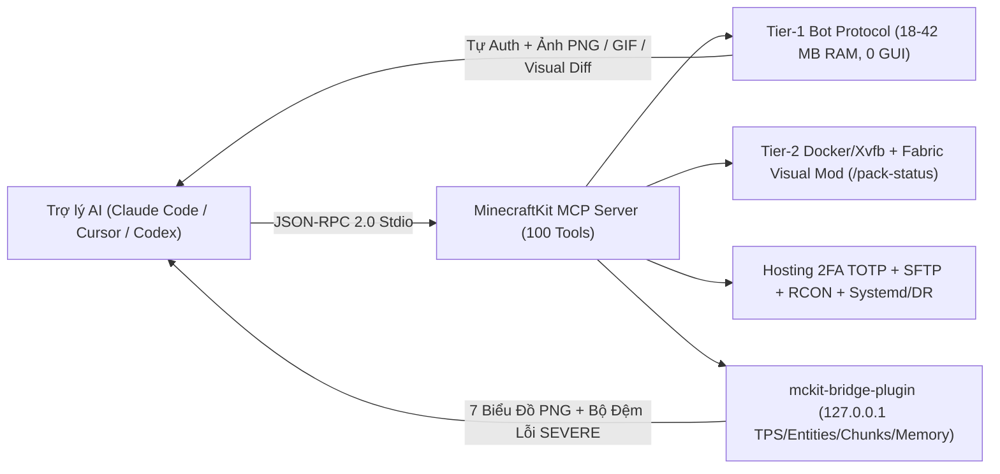

# Salyyy Minecraft Kit (v9.7.0 FLAGSHIP — 100 MCP Tools · 7 Biểu Đồ PNG · 10-Engine Offline Lab · 12 Bot Presets!)

[English (README.md)](README.md) · [**Trang Giới Thiệu Chính (Showcase)**](https://salyys1.github.io/minecraftkit/showcase.html) · [RPG API Explorer](https://salyys1.github.io/minecraftkit/) · [Ecosystem Atlas](https://salyys1.github.io/minecraftkit/ecosystem.html) · [Diagnostics Lab](https://salyys1.github.io/minecraftkit/playground.html) · [Wiki Song Ngữ](https://salyys1.github.io/minecraftkit/wiki.html) · [Hướng Dẫn Hosting 2FA & SFTP](docs/HOSTING_2FA_SFTP_GUIDE.md) · [Benchmark Tối Ưu RAM Bot](docs/BOT_OPTIMIZATION_BENCHMARKS.md) · [Chiến Lược Cộng Đồng](docs/GROWTH_STRATEGY.md)

[](https://github.com/SalyyS1/minecraftkit/actions/workflows/ci.yml)
[](https://github.com/SalyyS1/minecraftkit/releases/tag/v9.7.0)
[](https://modelcontextprotocol.io)

Bộ công cụ **AI Engineering, Autonomous Bot QA & Server Ops** toàn diện cho hệ sinh thái Minecraft (`Paper`, `Folia`, `Purpur`, `Velocity`, `Geyser/Bedrock`, `Fabric`, `MythicMobs`, `MMOItems`, `ModelEngine`, `Skript`, `WorldGuard`) với **100 công cụ MCP chuẩn JSON-RPC 2.0**, **14 lệnh/kỹ năng `/mc:*`**, **Bot Kiểm Thử Tự Động siêu nhẹ (~18–42 MB RAM/bot, không cần mở app Minecraft, không chiếm màn hình)**, **7 biểu đồ PNG tự động đính kèm vào chat (TPS, Entity Lag, Chunk Density, JVM Heap, GC Pause, Bot Load-Test, Executive Release Scorecard)**, **Bảng Điểm Quyết Định Ra Mắt GO/NO-GO**, **6 mẫu Cloud/Docker chống nổ RAM (gồm cả Oracle Cloud Always-Free 24 GB ARM64 miễn phí $0/tháng)**, **Kết nối Hosting/VPS có 2FA TOTP & SFTP ngầm (có rollback `.mckit.bak` tự động)**, **Plugin/Mod Companion Java 21**, và **tích hợp trọn bộ 10 repo Minecraft của SalyVn / Salyyy**.



## Vì Sao Không Cần Mở 10 Tab Minecraft?

| Chế độ kiểm thử | RAM cho 10 Bot | Chiếm màn hình? | Phù hợp cho |
| :--- | :--- | :--- | :--- |
| **10 Tab Minecraft Desktop** | ~26.0 GB (nổ máy!) | Có (cướp focus liên tục) | Không nên dùng |
| **Tier-1 Headless Protocol (`bot/` + `mc_proto_client.py`)** | **~180–420 MB** | **Không (0 GUI)** | AuthMe/nLogin, lệnh, Shop/GUI, Inventory, Scoreboard, Stress Test |
| **Tier-2 Hybrid (1 Docker/Xvfb Visual + 9 Protocol)** | **~1.3 GB** | **Không (chạy ngầm)** | Kiểm tra Shader GLSL, Resource Pack 3D, quay GIF/MP4 |

## Các Nhóm Tính Năng Cốt Lõi (v9.0.0)

1. **Bot Kiểm Thử Tự Động Không Chiếm Màn Hình (`bot/`, `mc_bot_*`)**:
   - Tự join server Java (`1.20.4`–`26.3`, kiểm tra ma trận ViaVersion/ViaBackwards/Geyser qua `mc_bot_probe_protocol_matrix`) & Bedrock/Geyser UDP (`mc_bot_ping_bedrock`).
   - Tự nhận diện thông báo **Tiếng Việt & Tiếng Anh** của AuthMe / nLogin / OpeNLogin / LimboAuth, tự gõ `/register` `/login` và **luôn che mật khẩu thành `[REDACTED_PASSWORD]`**.
   - Hỗ trợ đầy đủ hành động theo **Stages** hoặc **Tự do nhiều lượt (`mc_bot_session_*`)**: gửi lệnh, di chuyển (`move`), bấm slot GUI (`click_slot`), kiểm tra Chat / GUI / Inventory / Scoreboard, tự chụp **PNG giao diện**, **so sánh pixel Visual Diff (`mc_bot_visual_diff`)**, **ghép Storyboard PNG + Animated GIF (`mc_bot_record_stage_gif`)**, và **quay video MP4 (`mc_bot_capture_timelapse`)** trả thẳng vào khung chat AI!
   - Bộ chạy Pool đa bot (`bot/pool-runner.mjs`) có giới hạn chống tràn RAM (`max 25`), độ trễ giãn nhịp join và thống kê `p50/p95` + tổng RSS MB.
2. **Kết Nối Hosting / VPS (Có 2FA TOTP), RCON & SFTP Ngầm (`mc_hosting_*`, `mc_sftp_operations`, `mc_ops_*`)**:
   - Kết nối không chiếm màn hình tới **Pterodactyl, Pelican, Crafty Controller, PufferPanel, Multicraft** bằng domain, tài khoản/API key và mã **2FA TOTP chuẩn RFC 6238**.
   - **Kho Profile mã hoá quyền `chmod 0600` (`mc_ops_profile_vault`)**: lưu cấu hình một lần, hỗ trợ `env:TEN_BIEN`, tự ẩn mọi mật khẩu/token/secret.
   - **SFTP an toàn**: đọc `logs/latest.log` lọc lỗi, vá config có backup `.mckit.bak`, đẩy file `.jar` theo cơ chế atomic + SHA-256.
   - **VPS Anti-OOM & Docker Stack**: tính toán cờ JVM G1GC / Generational ZGC chống OOM, quy tắc tường lửa `ufw` (`mc_ops_vps_ssh_preflight`), và sinh trọn bộ `docker-compose` (`mc_ops_generate_docker_stack`).
3. **Companion Plugin & Fabric Client Mod (`bridge-plugin/`, `client-mod/`)**:
   - **`mckit-bridge-plugin`** (Paper/Folia Java 21, chỉ mở cục bộ `127.0.0.1:25590` xác thực `X-MCKit-Token`): đọc TPS/MSPT, **lịch sử TPS 60 giây tự vẽ biểu đồ PNG sparkline gửi vào chat**, **top 10 thực thể gây lag theo từng thế giới (`/api/v1/entities`)**, GUI đang mở của người chơi, và bộ đệm lỗi `SEVERE`.
   - **`mckit-client-mod`** (Fabric + Docker Xvfb): chụp ảnh khung hình 3D ngầm và thu thập lỗi tải Resource Pack / Shader (`/api/v1/errors`).
4. **Bộ Kiểm Toán Toàn Diện Không Cần Khởi Động Server (`mc_audit_*`, `mc_world_audit_integrity`)**:
   - Kiểm tra file thế giới Anvil `.mca` & `level.dat`, lỗ hổng dupe/exploit, bảo mật Velocity/Paper/Geyser forwarding, quyền LuckPerms RBAC, HikariCP/SQL pool, hồ sơ lag Spark/Timings, Datapack 1.21+, và Shader GLSL 1.21+.
5. **Tích Hợp Trọn Bộ 10 Repo Minecraft Của SalyVn (`mc_suite_full_ecosystem_doctor`, `mc_qa_run_full_lifecycle`)**:
   - `mcstage`, `shadersmith`, `packmigrate`, `packmerge`, `glyphsmith`, `pluginscope`, `serverdoctor`, `foliascan`, `rp-engine`, `texlab` + **41.887 API plugin RPG offline** (`ModelEngine`, `MMOItems`, `MMOCore`, `MythicCrucible`, `MythicDungeons`...).

## Cài Đặt Nhanh (1 Dòng)

```bash
npx minecraftkit install --target both
npx minecraftkit mcp --print-config
```

Cấu hình MCP cho **Claude Code / Cursor / Windsurf / Antigravity / Codex**:

```json
{
  "mcpServers": {
    "minecraftkit": {
      "command": "npx",
      "args": ["-y", "minecraftkit", "mcp"]
    }
  }
}
```
